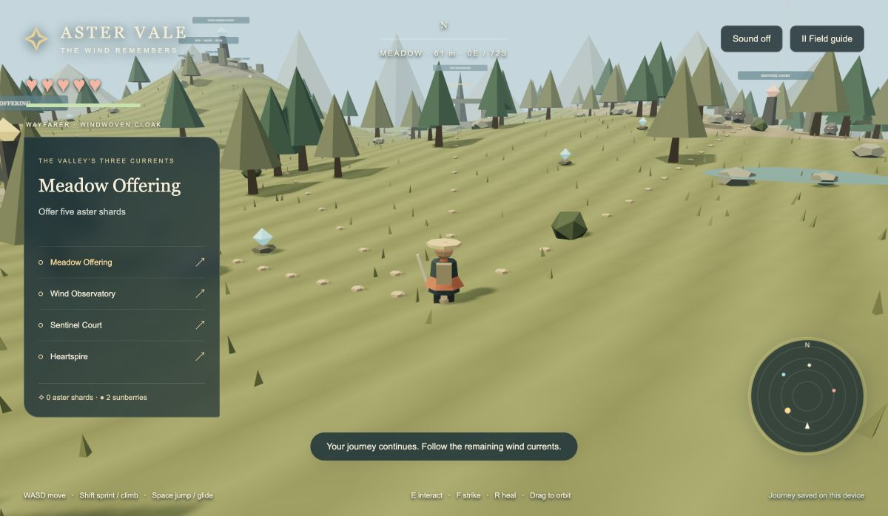

# Aster Vale

An original playable wilderness adventure about returning three wind currents to their home. Explore a low-poly valley, climb its highland, glide across the landscape, gather aster shards, align ancient wind dials and quiet stone sentinels before awakening the Heartspire.

Inspired by the exploration and traversal spirit of Breath of the Wild. All world geometry, characters, text, colors and synthesized audio are original; no Nintendo assets are used.

## Play locally

Requires Node.js 24 and npm. From this repository:

```bash
npm ci
npm run dev
```

Open **http://127.0.0.1:5174/**. The server binds locally and uses a strict separate port; it does not affect Driftwood Bay on 5173. If restarting, stop this game's existing server with Ctrl-C first. There is no public deployment or paid service.

- WASD / arrows: move relative to the camera
- Shift: sprint and climb steep ground, spending stamina
- Space: jump; press again while airborne to open or close the glider
- E: gather, turn dials, awaken beacons, rest or finish
- F: strike nearby sentinels; retreat when their warning ring lights up
- R: heal with a sunberry
- Drag the landscape: orbit camera
- Escape / Field guide: pause, help and new journey

Small screens have on-screen controls and a collapsible destination list. Save progress stays on the current browser/device. Resting beacons restore health; defeat preserves discoveries. New Journey has an explicit confirmation.

## Validate

```bash
npm run typecheck
npm test
npm run build
```

Ten tests exercise public gameplay and save/load behavior. CI repeats the same commands on every push. See [QA evidence](docs/QA.md), [separate reviews](docs/REVIEW.md), [acceptance specification](docs/SPEC.md), [glossary](GLOSSARY.md), [architecture decision](docs/adr/0001-browser-world.md) and [skill adaptations](docs/WORKFLOW.md).


